# Parley — Offline Interpreter (macOS)

Phiên dịch realtime mọi âm thanh trên máy Mac (Zoom/Meet/Teams, YouTube, video…) và giọng của bạn qua micro — **hoàn toàn offline**, chọn được cặp ngôn ngữ bất kỳ mà Apple hỗ trợ. Kèm bộ công cụ học từ vựng, ngữ pháp và phát âm tiếng Anh.

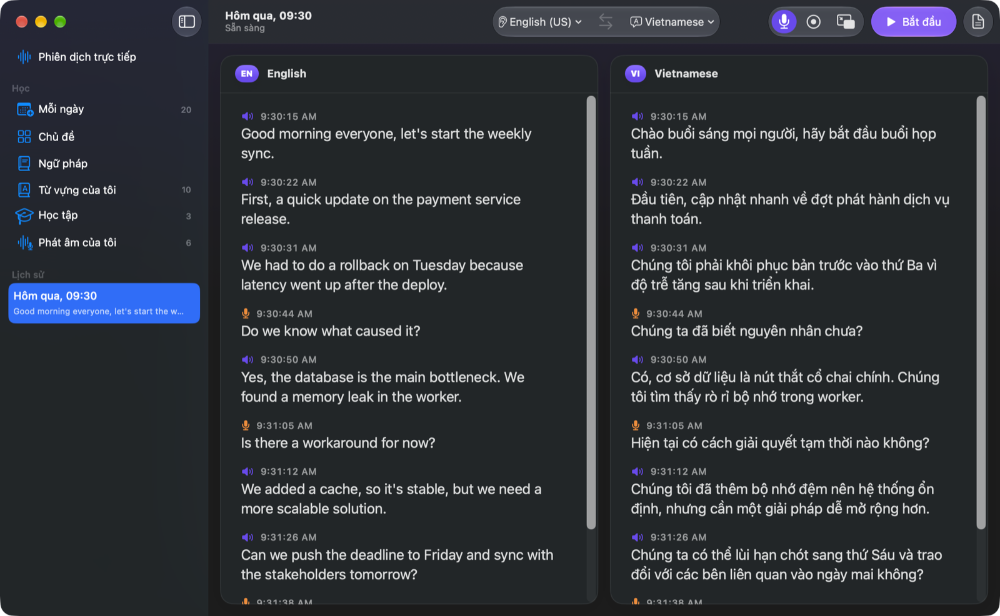

## Ảnh chụp màn hình

> Ảnh chụp từ app thật, dùng dữ liệu mẫu (một buổi họp IT, 12 từ đã lưu).

### Phiên dịch & lịch sử
| Sẵn sàng phiên dịch | Cấp quyền lần đầu |
|---|---|
| 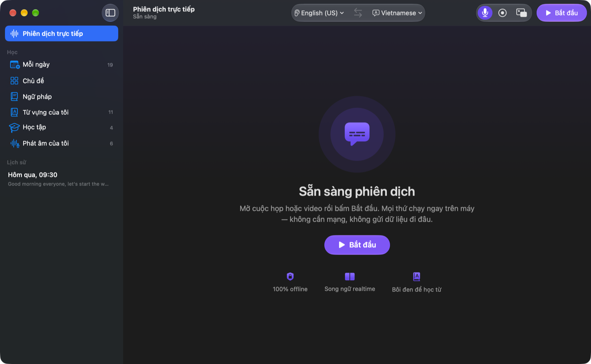 | 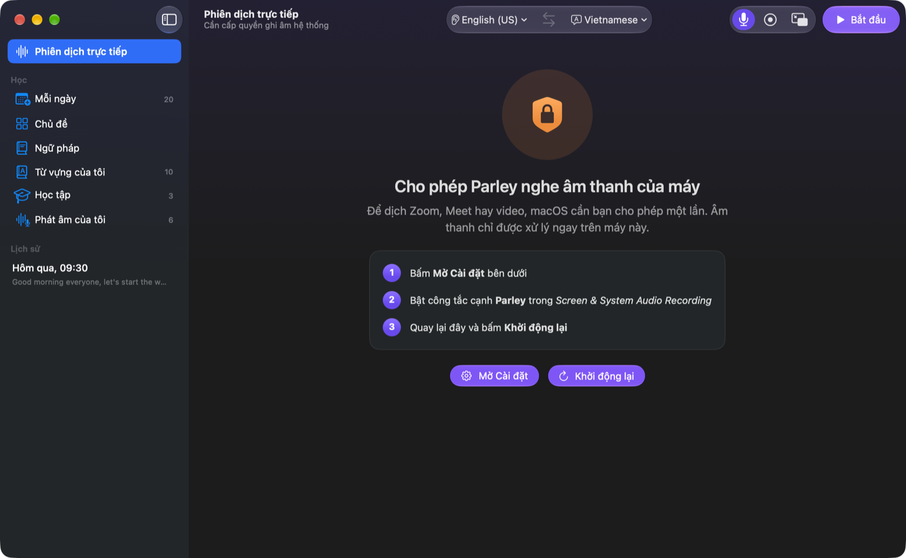 |
| Chọn cặp ngôn ngữ trên thanh công cụ, bấm **Bắt đầu**. | Lần đầu app hướng dẫn bật *Screen & System Audio Recording*. |

| Phiên đã lưu — song ngữ theo thời gian | Bôi đen để tra từ |
|---|---|
|  | 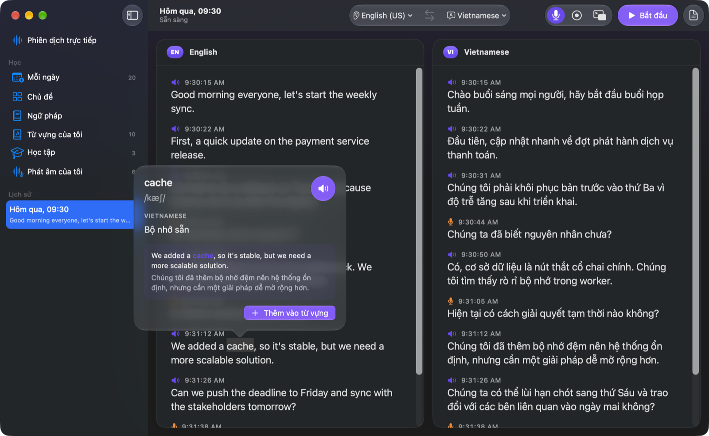 |
| 🔊 = âm thanh máy (người khác nói), 🎤 = micro (bạn nói). Bấm một dòng để nghe lại. | Nghĩa, IPA, nút nghe đọc, câu gốc + bản dịch, **Thêm vào từ vựng**. |

### Dịch văn bản & ảnh
| Tiếng Nhật → tiếng Việt | Cửa sổ hẹp |
|---|---|
| 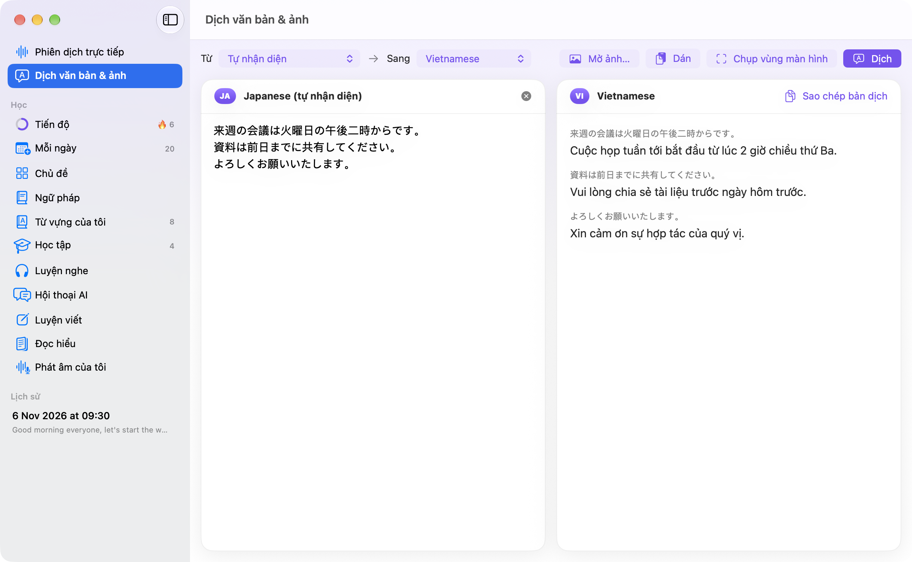 | 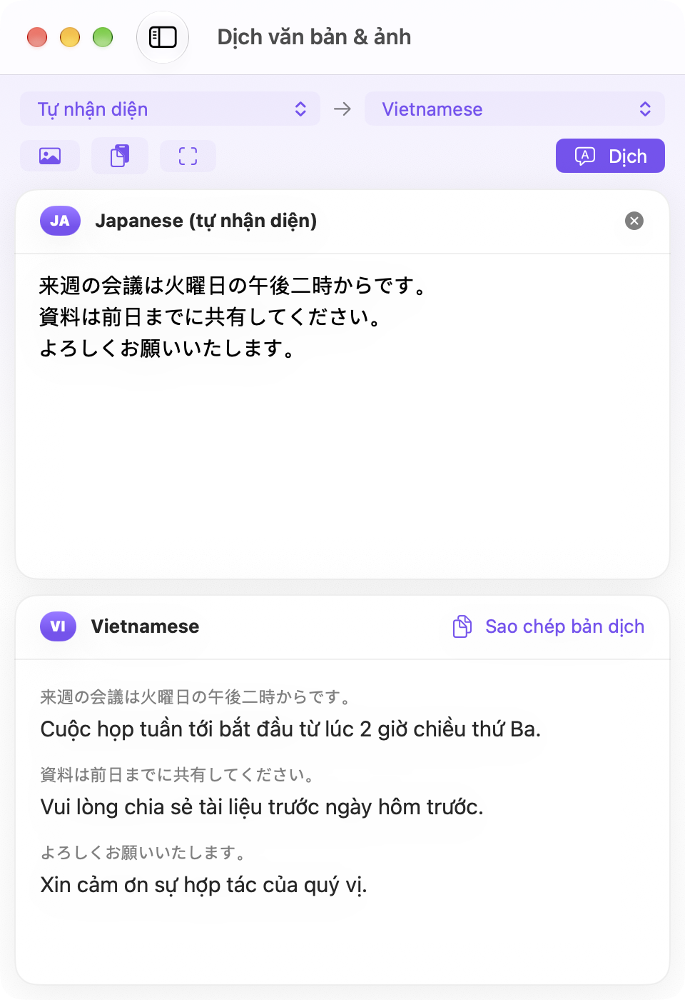 |
| Gõ/dán chữ, **Mở ảnh…**, kéo thả ảnh, **Dán** ảnh chụp, hoặc **Chụp vùng màn hình** (manga, game, PDF…) → đọc chữ trên máy → dịch từng đoạn. Tự nhận diện ngôn ngữ. | Nút thu thành biểu tượng (di chuột để xem tên). |

### Từ vựng
| Từ vựng của tôi | Mỗi ngày — 20 từ mới/ngày |
|---|---|
| 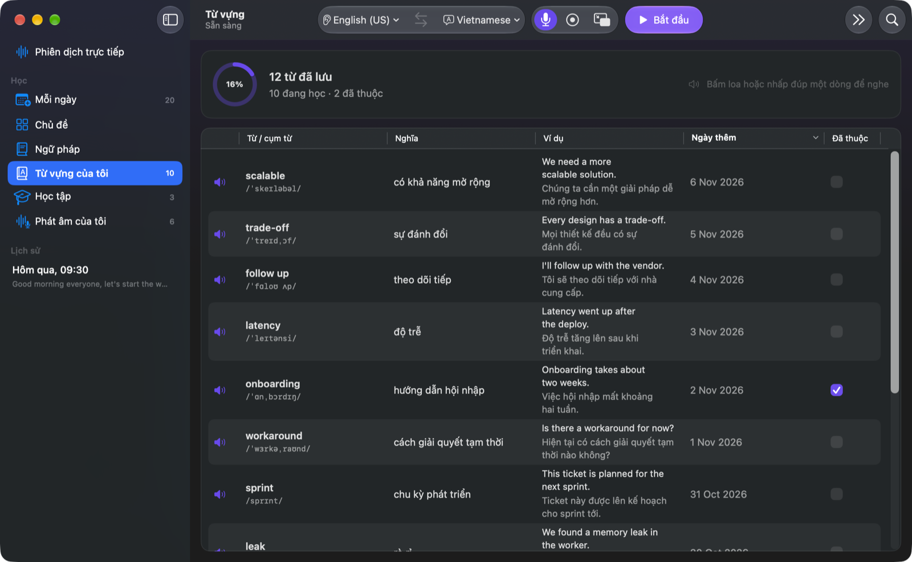 | 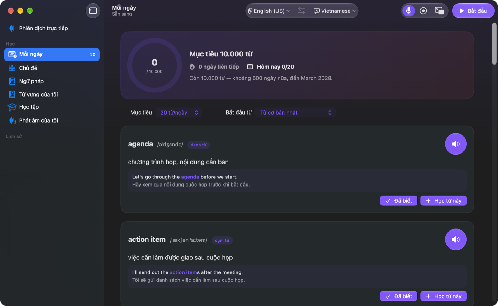 |
| Bảng từ đã lưu: IPA, nghĩa, câu ví dụ, ngày thêm, đã thuộc. | Kế hoạch tới 10.000 từ: "Đã biết" hoặc "Học từ này". |

| Danh mục chủ đề | Chủ đề con (IT) | Từ trong chủ đề |
|---|---|---|
| 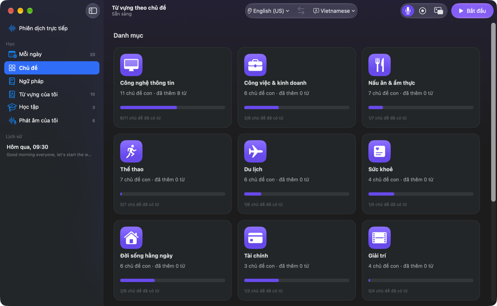 | 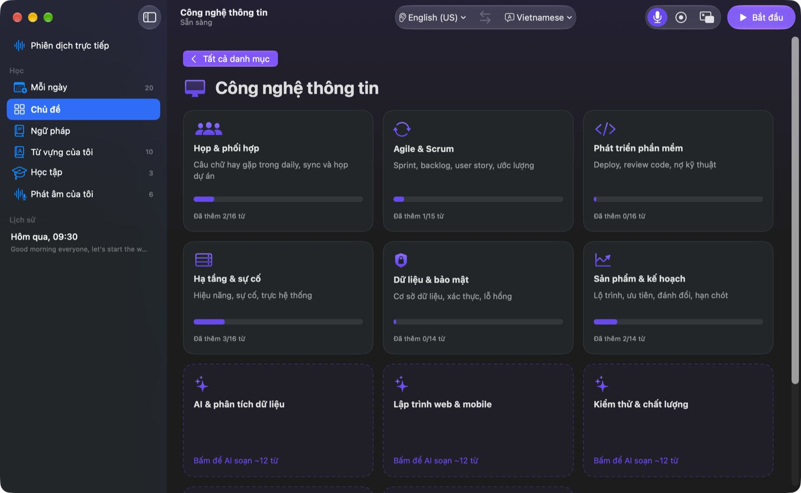 | 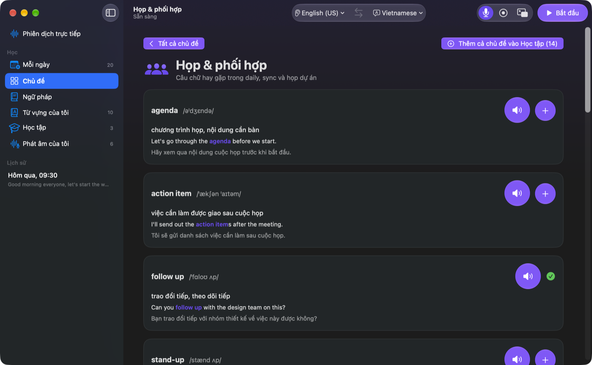 |

### Ngữ pháp
| Lộ trình A1 → C1 | Một bài học |
|---|---|
| 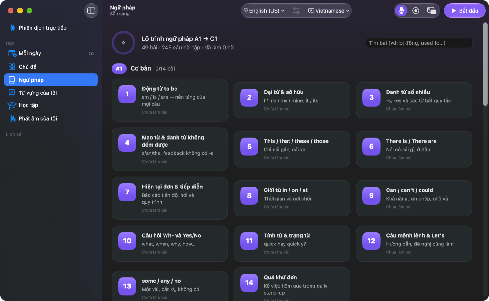 | 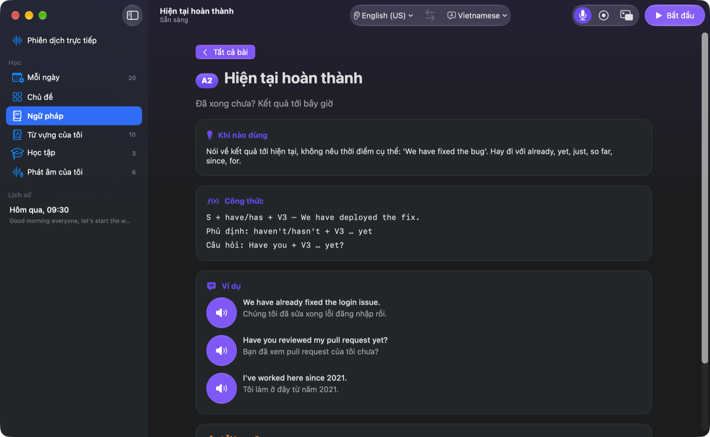 |
| 49 bài, 245 câu bài tập, tìm kiếm theo tên bài. | Khi nào dùng, công thức, ví dụ có đọc mẫu, lỗi hay gặp, trắc nghiệm. |

### Luyện tập & phát âm
| Học tập — 6 chế độ + game | Thử thách tổng hợp |
|---|---|
| 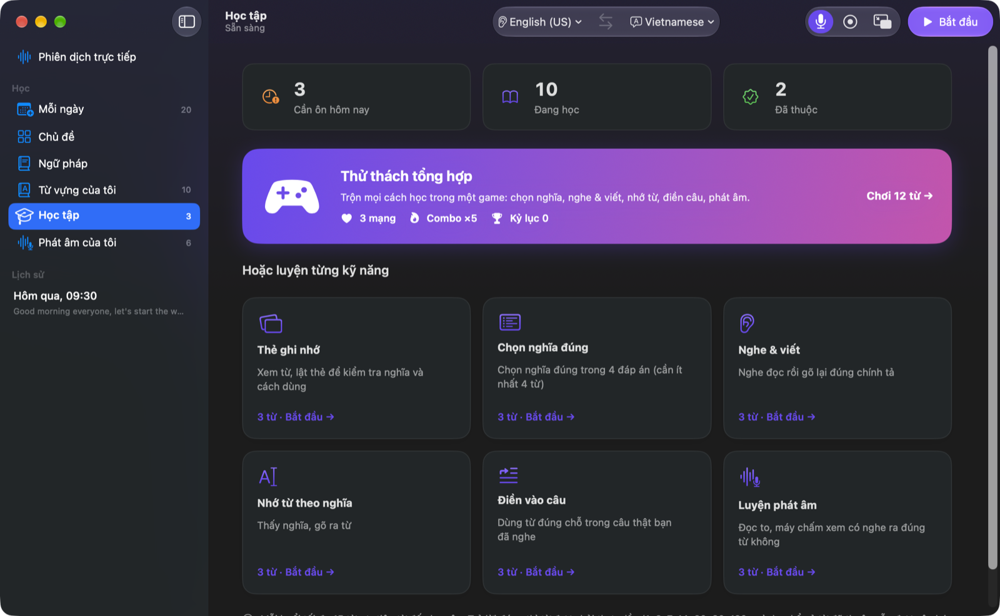 | 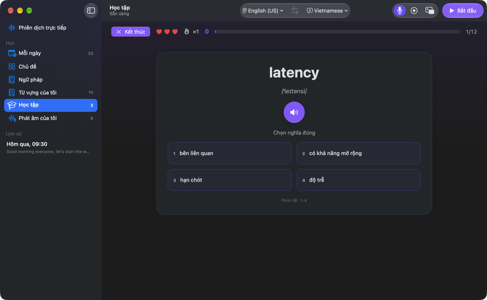 |
| Số từ cần ôn hôm nay, đang học, đã thuộc. | 3 mạng, combo, kỷ lục — trộn mọi cách học. |

| Điền vào câu | Phát âm của tôi |
|---|---|
| 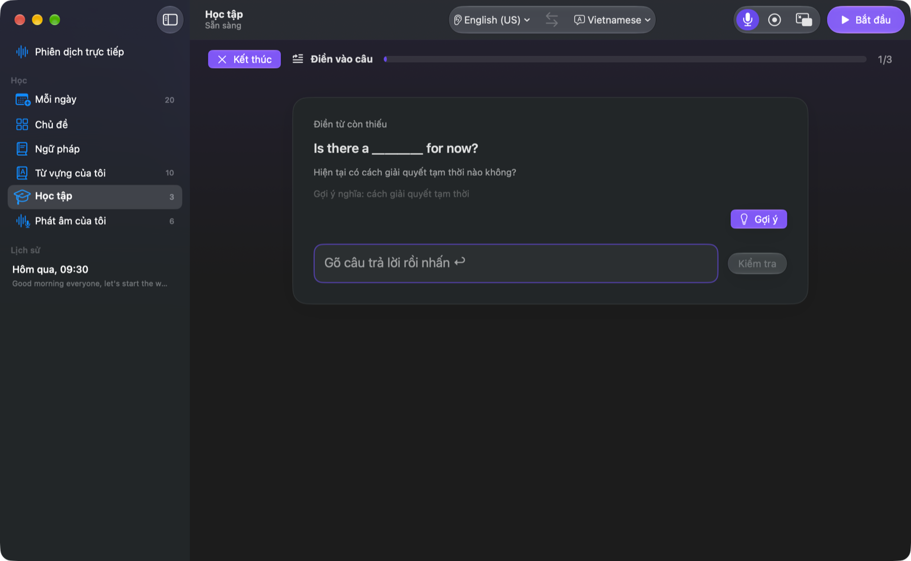 | 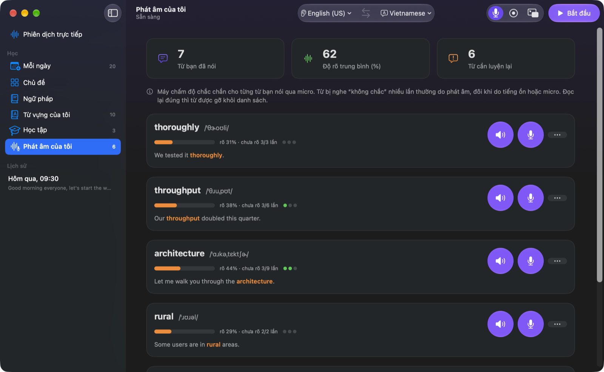 |
| Dùng câu thật bạn đã nghe trong cuộc họp, có gợi ý. | Từ máy nghe chưa rõ khi bạn nói; đọc đúng 3 lần liên tiếp để gỡ khỏi danh sách. |

## Tính năng
- **Song ngữ realtime**: thẻ trái = ngôn ngữ đang nghe, thẻ phải = bản dịch. Chữ tím có con trỏ ▍ = đang nói.
- **Chọn ngôn ngữ** trên thanh công cụ (nghe ⇄ dịch sang), nút đổi chiều (⌘⇧L). Nghe được cả tiếng Nhật, tiếng Trung…
- **Dịch văn bản & ảnh**: chữ, ảnh, ảnh trong bộ nhớ tạm, vùng màn hình → OCR (Vision) + dịch, không cần mạng. `Parley --translate-image <ảnh> [--target en]` chạy từ dòng lệnh.
- **Học từ**: bôi đen từ/cụm từ → thẻ hiện nghĩa, phiên âm IPA (tiếng Anh), nút 🔊 nghe đọc, câu ví dụ, **Thêm vào từ vựng**.
- **Từ vựng**: bảng có tìm kiếm, lọc Đang học/Đã thuộc, sắp xếp, nhấp đúp để nghe, tiến độ %. Lưu ở `~/Documents/Parley/vocabulary.json`.
- **Mỗi ngày**: kế hoạch 20 từ mới/ngày (đổi được 10–50) hướng tới 10.000 từ — ưu tiên từ chủ đề soạn sẵn (IT trước), sau đó ~8.800 từ thông dụng theo tần suất. "Học từ này" → vào lịch ôn; "Đã biết" → tính vào tổng. Nghĩa dịch offline, câu ví dụ tạo bằng AI trên máy (Apple Foundation Models).
- **Chủ đề**: các danh mục (Công nghệ thông tin, Công việc & kinh doanh, Du lịch, Sức khoẻ, Tài chính…) chia thành chủ đề con; tự tạo chủ đề mới bằng AI trên máy.
- **Ngữ pháp**: lộ trình A1 → C1 (49 bài, 245 câu bài tập) với ví dụ, lỗi hay gặp và trắc nghiệm.
- **Học tập**: 6 chế độ + game "Thử thách tổng hợp"; ôn ngắt quãng 1→3→7→14→30→60→120 ngày (từ đã thuộc vẫn được ôn lại).
- **Phát âm của tôi**: từ máy nghe chưa rõ khi bạn nói qua micro; đọc đúng 3 lần liên tiếp để gỡ khỏi danh sách.
- **Lịch sử**: mỗi phiên lưu `<ngày-giờ>.md` (song ngữ) + `-may.m4a` / `-mic.m4a` (ghi âm) + `-screen.mov` (nếu bật Quay màn hình). Chuột phải → Hiện trong Finder / Chuyển vào Thùng rác.
- **Cửa sổ mini** (⌘⇧P): luôn nổi trên cùng ở góc màn hình, hợp khi đang họp; ⌘⇧0 về cửa sổ đầy đủ.

## Tải về và cài đặt

### Máy cần có

| | Tối thiểu | Ghi chú |
|---|---|---|
| Máy Mac | **Apple Silicon** (M1, M2, M3, M4 trở lên) | Không chạy trên Mac chip Intel. Kiểm tra:  → *Giới thiệu về máy Mac này* → *Chip*. |
| Hệ điều hành | **macOS 26 Tahoe** trở lên | Phiên dịch, đọc chữ trong ảnh, nhận giọng nói đều dùng thư viện có sẵn của macOS 26. |
| Bộ nhớ | 8 GB RAM; trống khoảng **3 GB** | App chỉ 14 MB; phần còn lại là mô hình nhận giọng nói và gói dịch macOS tự tải (mỗi ngôn ngữ vài trăm MB). |
| Apple Intelligence | Không bắt buộc | Cần cho Hội thoại AI, Luyện viết, câu ví dụ và bài đọc tạo bằng AI (*Cài đặt hệ thống → Apple Intelligence & Siri*, cần thêm ~7 GB). Mọi tính năng khác chạy không cần. |
| Mạng | Chỉ lần đầu | Để macOS tải mô hình giọng nói và gói dịch. Sau đó Parley chạy **hoàn toàn offline** — không gửi âm thanh hay chữ đi đâu. |
| Micro, loa / tai nghe | Micro trong máy là đủ | Tai nghe giúp micro không thu lại tiếng loa khi phiên dịch. |

### Cài trong 4 bước

1. **Tải về**: mở [trang Releases](https://github.com/deputychinh/Parley/releases/latest) và tải file
   `Parley-<phiên-bản>-macOS-arm64.zip` (mục *Assets*).
2. **Giải nén** (bấm đúp file zip) rồi **kéo `Parley.app` vào thư mục *Applications***.
3. **Mở lần đầu**: macOS sẽ báo *“Apple không thể kiểm tra Parley…”* vì app chưa được Apple công chứng (notarize —
   việc này cần tài khoản nhà phát triển trả phí; mã nguồn app nằm công khai ngay tại đây). Cách mở:
   - Bấm **Xong**, vào ** → Cài đặt hệ thống → Quyền riêng tư & Bảo mật**, kéo xuống mục *Bảo mật*, bấm
     **Vẫn mở** (*Open Anyway*) cạnh dòng “Parley đã bị chặn”, nhập mật khẩu máy, rồi bấm **Mở**.
   - Hoặc trong Terminal: `xattr -dr com.apple.quarantine /Applications/Parley.app` rồi mở app như bình thường.

   Chỉ cần làm một lần.
4. **Cấp quyền** khi app hỏi (hoặc trong *Cài đặt hệ thống → Quyền riêng tư & Bảo mật*):
   - **Ghi màn hình & âm thanh hệ thống** — để nghe âm thanh cuộc họp / video. Bật xong, mở lại app.
   - **Micro** — để dịch giọng bạn và chấm phát âm.
   - Lần đầu chọn một cặp ngôn ngữ, bấm **Tải gói dịch** khi app nhắc.

### Kiểm tra file tải về (không bắt buộc)

Mỗi bản phát hành có file `.sha256` đi kèm. Trong Terminal, ở thư mục chứa file zip:
```bash
shasum -a 256 -c Parley-<phiên-bản>-macOS-arm64.zip.sha256
```

### Cập nhật và gỡ cài đặt

- **Cập nhật**: tải bản mới, kéo đè `Parley.app` vào *Applications*. Dữ liệu học và lịch sử vẫn giữ nguyên.
- **Dữ liệu** nằm ở `~/Documents/Parley` (từ vựng, tiến độ, phiên đã lưu — đổi được trong *Cài đặt*).
- **Gỡ**: kéo `Parley.app` vào Thùng rác; xoá thêm `~/Documents/Parley` nếu không cần dữ liệu nữa.

## Build từ mã nguồn (cho lập trình viên)

Cần thêm **Xcode 26+** (bản đầy đủ, không chỉ Command Line Tools — cần các macro plugin của SwiftUI /
FoundationModels).

```bash
git clone https://github.com/deputychinh/Parley.git
cd Parley
./build.sh                 # build → build/Parley.app
open build/Parley.app      # chạy thử
# hoặc cài vào /Applications và mở luôn:
./build.sh install
```

Nếu `swift build` báo lỗi kiểu `plugin for module 'SwiftUIMacros' not found`, máy đang dùng Command Line Tools thay vì Xcode. Chọn Xcode rồi build lại:
```bash
sudo xcode-select -s /Applications/Xcode.app/Contents/Developer
# hoặc chỉ cho một lần build:
DEVELOPER_DIR=/Applications/Xcode.app/Contents/Developer ./build.sh
```

**Giữ quyền qua các lần build (tuỳ chọn):** `build.sh` ký app bằng chứng chỉ tên `LiveTranslate Local Signing` nếu có trong Keychain; nếu không sẽ ký ad-hoc và macOS sẽ hỏi lại quyền sau mỗi lần build. Tạo chứng chỉ tự ký trong *Keychain Access → Certificate Assistant → Create a Certificate…* (loại *Code Signing*) với đúng tên đó.

## Sử dụng
1. **Lần đầu mở app**: cho phép **Screen & System Audio Recording** và **Microphone** (System Settings → Privacy & Security), rồi mở lại app.
2. **Chọn ngôn ngữ** trên thanh công cụ: bên trái là ngôn ngữ đang nghe, bên phải là ngôn ngữ dịch sang. Nếu app báo *Cần tải gói dịch*, bấm **Tải gói dịch** — gói chỉ tải một lần, sau đó dịch hoàn toàn offline.
3. Mở cuộc họp / video rồi bấm **Bắt đầu** (⌘R). Bản gốc và bản dịch hiện song song theo thời gian thực.
4. Bật/tắt micro (⌘⇧M) để dịch cả giọng của bạn, bật quay màn hình (⌘⇧R) nếu muốn lưu video phiên họp.
5. **Bôi đen** một từ trong transcript để xem nghĩa, IPA, nghe đọc và **Thêm vào từ vựng**.
6. Bấm **Dừng** (⌘R) — phiên được lưu vào mục **Lịch sử** ở sidebar.
7. Ôn luyện ở các mục **Mỗi ngày**, **Chủ đề**, **Ngữ pháp**, **Học tập**, **Phát âm của tôi**.

Mẹo: dùng tai nghe để micro không thu lại tiếng loa.

### Phím tắt
| Phím | Chức năng |
|---|---|
| ⌘R | Bắt đầu / dừng |
| ⌘⇧L | Đổi chiều ngôn ngữ |
| ⌘⇧M | Bật/tắt micro |
| ⌘⇧R | Bật/tắt quay màn hình |
| ⌘⇧P / ⌘⇧0 | Cửa sổ mini / về cửa sổ đầy đủ |
| ⌘+ / ⌘− | Cỡ chữ |
| ⌘, | Cài đặt |

### Tham số dòng lệnh (debug)
> Chạy thử với dữ liệu mẫu (`--data-dir <thư mục>`) phải dùng bản `build/Parley-sandbox.app` (`make sandbox-app`) — bản thật sẽ từ chối, để không ghi vào cài đặt của bạn.

```bash
open build/Parley.app --args --autostart [--record-screen]   # tự bắt đầu phiên
open build/Parley.app --args --route grammar                  # mở thẳng một màn hình: daily|topics|grammar|vocabulary|practice|pronunciation|history
open build/Parley.app --args --route grammar --open perfect   # mở một bài ngữ pháp / danh mục (it) / chủ đề (meetings) / chế độ luyện (mix, cloze…)
open build/Parley.app --args --route history --select cache   # mở phiên gần nhất và tra sẵn một từ
open build/Parley.app --args --mini                           # mở kèm cửa sổ mini
```

## Kiến trúc (chỉ dùng framework có sẵn của macOS 26+)
| Phần | File | Công nghệ |
|---|---|---|
| Thu âm thanh máy + micro, quay màn hình | `SystemAudio.swift` | ScreenCaptureKit |
| Giọng nói → chữ (offline, kết quả tạm theo từ) | `Transcriber.swift` | SpeechAnalyzer / SpeechTranscriber |
| Dịch, lọc tiếng vọng loa→micro, lưu phiên | `Model.swift` | Translation |
| Khung transcript bôi đen được | `TranscriptView.swift` | NSTextView |
| Từ vựng, đọc, IPA | `Vocabulary.swift` | AVSpeechSynthesizer, CMU Pronouncing Dictionary (BSD, `Resources/`) |
| Kế hoạch học, chủ đề, ngữ pháp | `Library.swift` | Foundation Models (câu ví dụ AI trên máy) |
| Luyện tập, phát âm | `Practice.swift`, `Pronunciation.swift` | SwiftUI |
| Giao diện | `Views.swift`, `App.swift` | SwiftUI (Liquid Glass) |

## Tự kiểm tra
```bash
make ci        # kiểm tra offline, build release, kiểm thử đơn vị
make pipeline  # nhận dạng giọng nói + dịch thật trên file `say` (tiếng Anh, và tiếng Nhật nếu có giọng Kyoko)
.build/release/Parley --file /tmp/t.aiff --source ja_JP --target vi   # file bất kỳ, chọn ngôn ngữ
```
Luôn build qua `make` / `./build.sh`: `swift build` trực tiếp ghi sai phiên bản SDK vào binary (xem `scripts/link-flags.sh`) và macOS 27 sẽ báo thiếu gói dịch tiếng Nhật.

## Lưu ý
- Quay màn hình ≈ 40 MB/phút.
- `Resources/wordlist.txt` chỉ được phép dùng cá nhân/học tập (xem `Resources/wordlist-LICENSE.txt`) — thay bằng danh sách có giấy phép thương mại (vd. NGSL) trước khi phát hành.
- Trước khi lên App Store cần: tài khoản Apple Developer, Xcode project có App Sandbox + entitlements (audio-input, user-selected files), ký bằng chứng chỉ Developer ID/App Store thay cho chứng chỉ tự ký.
- Đổi tên app: chỉ sửa `CFBundleName` / `CFBundleDisplayName` trong `Info.plist`.
